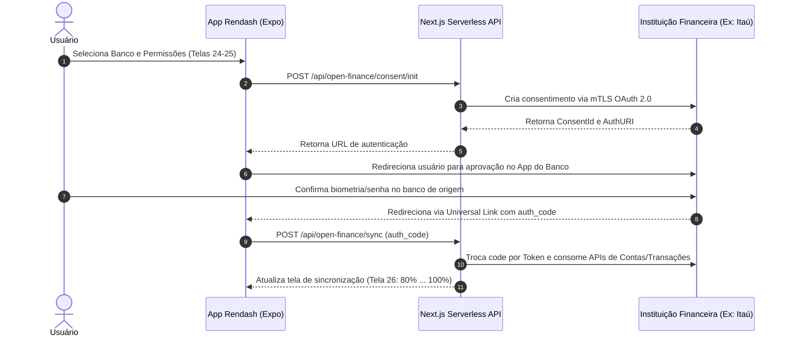

# Skill: Open Finance Engine & Motor de Classificação Inteligente

Esta skill especifica os fluxos de integração com o ecossistema do **Open Finance Brasil** e o mecanismo de enriquecimento e classificação automática de transações Pix do **Rendash**.

---

## 1. Ciclo de Vida do Consentimento Open Finance

O processo segue as diretrizes do Banco Central do Brasil (BACEN):



---

## 2. Máquina de Estados da Sincronização

Durante a sincronização (Telas 26, 27 e 28), o backend e frontend devem gerenciar os seguintes estados:

| Estado | Descrição | Comportamento da UI |
|---|---|---|
| `CONNECTING` | Conectando aos servidores do banco | Loader circular nativo com animação suave |
| `IMPORTING_ACCOUNTS` | Obtendo dados de contas corrente e poupança | Checklist item 1 marcado como Concluído |
| `IMPORTING_TRANSACTIONS`| Baixando histórico dos últimos 12 meses | Contador dinâmico de transações (Ex: 1.936... 2.847) |
| `SYNC_SUCCESS` | Dados consolidados no PostgreSQL | Tela de sucesso com saldo atualizado (Tela 28/29) |
| `SYNC_ERROR` | Falha temporária no parceiro ou timeout | Tela de erro com código de diagnóstico (Ex: `OF-408`) e botão de retentativa |

---

## 3. Motor de Classificação Inteligente de Pix & Transações

O Rendash possui um pipeline de enriquecimento em camadas para cada movimentação recebida (Telas 35 a 38):

1. **Camada 1: Regras Estritas do Usuário (`CategorizationRule`)**
   - O sistema verifica se existe regra cadastrada para o padrão de texto ou CPF do contato:
   ```typescript
   const rule = await prisma.categorizationRule.findFirst({
     where: {
       userId,
       applyAutomatic: true,
       OR: [
         { patternText: { contains: transaction.title, mode: 'insensitive' } },
         { patternText: transaction.counterpartDoc ?? '' }
       ]
     },
     include: { category: true }
   });
   ```

2. **Camada 2: Heurística por CNAE / Merchant Name**
   - Se o nome do estabelecimento contiver palavras-chave como `"Supermercado"`, `"Uber"`, `"Figma"` ou `"Petrobras"`, associa diretamente às categorias `"Alimentação"`, `"Mobilidade"`, `"Software"` ou `"Investimentos"`.

3. **Camada 3: Aprendizado Contínuo com Consentimento**
   - Quando o usuário altera manualmente a categoria de um Pix na tela 36 (ex: classificando Pix de *Marina Costa* como *Serviços* e marcando o toggle *"Aplicar automaticamente"*), o sistema grava uma nova `CategorizationRule` no banco de dados para automação imediata das próximas movimentações.
